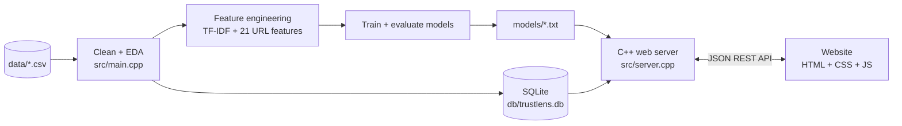

<div align="center">

# 🛡️ TrustLens

### Fake News & Phishing Detection Website — built end-to-end in C++17

Paste a suspicious link or a news article and get a verdict, a risk score, and **the reasons behind it**.
A complete data science project: raw CSV → SQL → machine learning → REST API → website.


</div>

---

## Table of contents

- [Why this project?](#why-this-project)
- [Features](#features)
- [Screenshots](#screenshots)
- [Quick start](#quick-start)
- [Architecture](#architecture)
- [Machine learning](#machine-learning)
- [SQL database](#sql-database)
- [REST API](#rest-api)
- [Project structure](#project-structure)
- [Using your own data](#using-your-own-data)
- [Security notes](#security-notes)
- [Limitations](#limitations)
- [Roadmap](#roadmap)
- [License](#license)

---

## Why this project?

Misinformation and phishing are two of the most common online threats, and both are *classification
problems*: is this article fake or real? Is this link a scam or legitimate?

TrustLens solves both with **no Python, no ML libraries and no web frameworks**. Every layer is written
from scratch, so each line can be read, understood and explained:

| Layer | Technology |
|---|---|
| Data pipeline | C++17: CSV parser, cleaning, EDA, evaluation |
| Machine learning | Logistic Regression, Naive Bayes, Decision Tree, Random Forest, TF-IDF (all from scratch) |
| Database | SQLite (6 tables, keys, constraints, indexes, a view) |
| Backend | C++17 HTTP server on POSIX sockets + JSON REST API |
| Frontend | HTML, CSS, vanilla JavaScript, hand-made SVG charts (no frameworks, no CDN) |

> ⚠️ **The bundled dataset is synthetic** (generated from templates so the project runs out of the box).
> Replace it with real data — see [Using your own data](#using-your-own-data).

---

## Features

- 🔗 **Phishing link scanner** — checks 21 warning signs in a web address (look-alike brands, raw IPs, shady endings, urgent keywords…) and lists the red flags in plain English. Links are **never opened**.
- 📰 **Fake-news checker** — reads the writing itself and shows which words and style signals pushed the verdict, with an honest confidence level.
- 📊 **Live dashboard** — 9 charts powered by SQL aggregate queries.
- 🔎 **Data explorer** — search, filter and page through both datasets; click a row to see what each model predicted.
- 🧠 **Model performance page** — leaderboard, confusion matrices, ROC curves, feature importance, top words.
- 🧪 **SQL Lab** — the project's 12 analysis queries (joins, window function, CTE…) with syntax highlighting, run live.
- 🌗 Light/dark theme, mobile-friendly, keyboard accessible, works fully offline.
- 🕘 Every scan is logged to a SQL table (`scan_history`).

---

## Screenshots

| Link scanner | Article checker |
|---|---|
|  |  |

| Dashboard | Model performance |
|---|---|
|  |  |

| SQL Lab (dark mode) | Mobile |
|---|---|
|  |  |

---

## Quick start

### Requirements

- A C++17 compiler (`g++` or `clang++`), `make`, and the SQLite development library
- **macOS**, **Linux**, or **Windows via [WSL](https://learn.microsoft.com/windows/wsl/install)** (the server uses POSIX sockets)

### 1. Install the tools (one time)

<details open>
<summary><b>🍎 macOS</b></summary>

```bash
xcode-select --install      # installs the compiler tools; SQLite is already built into macOS
```
</details>

<details>
<summary><b>🐧 Ubuntu / Debian / WSL</b></summary>

```bash
sudo apt update
sudo apt install -y g++ make sqlite3 libsqlite3-dev
```
</details>

### 2. Clone, build and run

```bash
git clone https://github.com/YOUR-USERNAME/trustlens.git
cd trustlens

make          # compile the pipeline, the data generator and the web server
make data     # create practice CSV files in data/
make run      # clean data, run EDA, train models, build the SQL database  (~6 s)
make serve    # start the website
```

Now open **http://localhost:8080** in your browser. Press `Ctrl + C` in the terminal to stop the server.

Next time you only need `make serve`.

### Build with CMake

The same application targets are available through CMake. Run these commands from the project
directory; the programs use project-relative data and output paths:

```bash
cmake -S . -B build
cmake --build build
./build/trustlens run
./build/trustlens_server
```

Open **http://127.0.0.1:8080**. The server target is available when SQLite development files are
installed. Without SQLite, CMake still builds the pipeline and data generator in script-only mode,
but the live website backend cannot run.

### Other commands

| Command | What it does |
|---|---|
| `make test` | quick self-test of the backend API |
| `./trustlens demo` | try the trained models in the terminal |
| `./trustlens predict-url "http://paypal-secure-login.xyz/verify"` | classify one URL from the command line |
| `./trustlens predict-news "SHOCKING!!! Share before it gets deleted!!!"` | classify one article from the command line |
| `./trustlens_server 9000` | use a different port (`--host 0.0.0.0` to allow other devices) |
| `make clean` | remove compiled programs |

> After re-running `make run` (new data or models), **restart** `make serve`.

<details>
<summary><b>Troubleshooting</b></summary>

| Problem | Fix |
|---|---|
| `Could not open the database` | Run `make run` before `make serve`. |
| `Address already in use` | Another program uses port 8080. Run `./trustlens_server 9000`. |
| `sqlite3.h: No such file or directory` | macOS: `xcode-select --install`. Linux: `sudo apt install libsqlite3-dev`. Then `make clean && make`. |
| `make: command not found` | Install the tools from step 1. |
| Windows | Use WSL and keep the project in the Linux home folder (`~`), not under `/mnt/c`. |
</details>

---

## Architecture



The data science life-cycle, step by step:

1. **Collect & clean** — read CSVs, drop duplicates, blanks and invalid labels (with a cleaning report)
2. **Explore (EDA)** — class balance, per-class statistics, correlations
3. **Store in SQL** — relational tables with keys, constraints and indexes
4. **Engineer features** — TF-IDF (unigrams + bigrams) for text; 21 "red-flag" numbers for URLs
5. **Train models** — four algorithms implemented from scratch
6. **Evaluate** — stratified train/test split, 5-fold cross-validation, ROC-AUC, confusion matrices
7. **Serve** — a C++ HTTP server exposes the models through a JSON API
8. **Explain** — the website shows the verdict *and* the evidence

---

## Machine learning

| Task | Features | Models |
|---|---|---|
| **Fake news** | TF-IDF of words + word pairs, plus exclamation rate, capital-letter ratio and length | Naive Bayes, Logistic Regression |
| **Phishing URLs** | 21 engineered features: lengths, dots, hyphens, digits, subdomains, IP-as-host, `@` symbol, HTTPS, keywords, shorteners, suspicious TLDs, entropy, brand mismatch… | Logistic Regression, Decision Tree, Random Forest |

**Results on held-out test data** (synthetic dataset, seed 42):

| Task | Model | Accuracy | F1 | AUC |
|---|---|---|---|---|
| Fake news | Naive Bayes | 0.904 | 0.901 | 0.904 |
| Fake news | Logistic Regression *(used by the site)* | 0.902 | 0.899 | 0.912 |
| Phishing | Logistic Regression | 0.919 | 0.908 | 0.984 |
| Phishing | Decision Tree | 0.988 | 0.986 | 0.985 |
| Phishing | Random Forest *(used by the site)* | 0.978 | 0.975 | 0.987 |

The majority-class baseline is about 0.53–0.55. Scores are deliberately below 100% because the
generator adds label noise and hard cases (calm fake news, legitimate login pages, HTTPS phishing).

**Good practice built in**

- TF-IDF and the feature scaler are fitted on **training data only** (no data leakage); cross-validation refits them inside every fold.
- The publisher column is stored in SQL for analysis but is **never used as a model feature**.
- Hyper-parameters are tuned with cross-validation on the training set only.
- The precision/recall trade-off is shown by moving the alert threshold.

---

## SQL database

Six tables: `news_articles`, `urls`, `url_features`, `model_runs`, `predictions`, `scan_history`
(see [`sql/schema.sql`](sql/schema.sql)) with primary/foreign keys, `CHECK` constraints, indexes and a view.

[`sql/analysis_queries.sql`](sql/analysis_queries.sql) contains 12 queries covering `GROUP BY`, `HAVING`,
joins, date functions, a window function (`RANK() OVER`), a CTE, and error analysis that joins model
predictions back to the source data. Try them on the **SQL Lab** page, or by hand:

```bash
sqlite3 -header -column db/trustlens.db "SELECT * FROM v_model_leaderboard;"
```

---

## REST API

| Method & path | Purpose |
|---|---|
| `POST /api/scan-url` `{"url": "..."}` | risk %, verdict, red flags, parsed address, the 21 features |
| `POST /api/check-news` `{"text": "..."}` | probability of fake, verdict, confidence, influential words |
| `GET /api/overview` · `/api/analytics` | headline numbers · data for the dashboard charts |
| `GET /api/models` · `/api/roc?task=&model=` | leaderboard, confusion counts, importance · ROC points |
| `GET /api/data/news` · `/api/data/urls` | paged, searchable, filterable dataset (`?q=&label=&page=`) |
| `GET /api/data/news/<id>` · `/api/data/urls/<id>` | one record + the models' stored predictions |
| `GET /api/sql-lab` · `/api/sql-lab/<n>` | list / run the prepared analysis queries |
| `GET /api/history` · `/api/examples` · `/api/health` | recent scans · random sample inputs · status |

```bash
curl -s -X POST http://localhost:8080/api/scan-url \
     -d '{"url":"http://paypal-secure-login.xyz/verify/account"}'
```

---

## Project structure

```
trustlens/
├── Makefile · CMakeLists.txt
├── src/
│   ├── main.cpp            data pipeline: clean → EDA → SQL → ML → report (+ CLI predict commands)
│   ├── server.cpp          web backend: static files + JSON API + model inference
│   └── generate_data.cpp   creates the practice CSV files
├── include/
│   ├── csv.hpp             CSV reader/writer          text.hpp          tokenizer, TF-IDF
│   ├── data.hpp            loading + cleaning         url_features.hpp  21 URL features
│   ├── eda.hpp             statistics, correlation    models.hpp        LR, NB, tree, forest
│   ├── metrics.hpp         F1, AUC, ROC, k-fold CV    http.hpp          HTTP server
│   ├── json.hpp            JSON helpers               sqlstore.hpp      SQLite wrapper
│   └── report.hpp · common.hpp
├── web/                    the website
│   ├── index · scanner · dashboard · explorer · models · sql-lab · about · 404 (.html)
│   ├── css/style.css       design system (light/dark, responsive)
│   └── js/                 site.js · charts.js · one script per page
├── sql/                    schema.sql · analysis_queries.sql
├── data/                   news.csv · urls.csv
├── docs/                   PROJECT_REPORT.md · screenshots/
├── scripts/smoke_test.sh   backend self-test (make test)
└── models/ · results/ · db/    generated outputs
```

A longer write-up (methodology, results discussion, ethics, viva questions) is in
[`docs/PROJECT_REPORT.md`](docs/PROJECT_REPORT.md).

---

## Using your own data

Replace the files in `data/`, then run `make run` and restart `make serve`. Every page updates itself.

**`data/news.csv`** — e.g. the Kaggle *Fake and Real News* dataset (only `text` and `label` are required):

```
id,title,text,subject,source,published_date,label        # label: 1 = fake, 0 = real
```

**`data/urls.csv`** — e.g. PhishTank/OpenPhish URLs (label 1) plus Tranco top sites (label 0):

```
id,url,label,source,collected_date                         # label: 1 = phishing, 0 = legitimate
```

For very large files, lower `max_features` in `src/main.cpp` or sample the data first.

---

## Security notes

- All SQL uses **bound parameters** (tested against injection strings).
- The frontend renders data with `textContent` (tested against HTML injection).
- Static files are protected against `../` path traversal; request sizes are limited.
- A Content-Security-Policy header blocks external scripts. The SQL Lab only runs fixed, read-only queries.
- Submitted links are **never fetched** — only the text of the address is analysed.

This is a learning project: it has **no login, no HTTPS and no rate limiting**. Keep the default
`127.0.0.1` binding, or put it behind a reverse proxy (nginx/Caddy) before exposing it publicly.

---

## Limitations

- **The demo data is synthetic.** Real-world scores will be lower.
- **The news model reads writing style, not truth.** It cannot fact-check; a calm, well-written lie can fool it.
- **The link scanner only reads the address**, never the page behind it.
- **Attackers adapt**, so models need regular retraining.
- Errors have costs: false alarms annoy users, missed attacks can cost money — the threshold is a human decision.

---

## Roadmap

- [ ] Train on real datasets (ISOT / LIAR, PhishTank + Tranco)
- [ ] Add k-NN / SVM and class weighting
- [ ] Domain-age (WHOIS) and page-content features for phishing
- [ ] Browser extension that calls `POST /api/scan-url`
- [ ] User accounts, HTTPS and rate limiting
- [ ] Docker image

---

## License

Released under the [MIT License](LICENSE).

<div align="center">

*Predictions are estimates, not guarantees. Always double-check important links and claims.*

</div>

